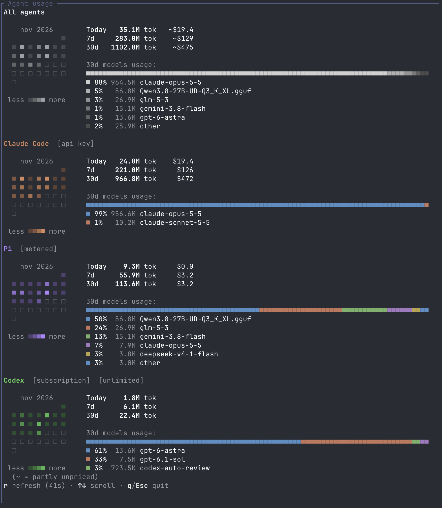

# herdr-usage

A [herdr](https://herdr.dev/tui/) plugin (`herdr-usage`) that shows how many tokens
your local coding agents spend: Claude Code, Codex, Pi and OpenCode. It reads
their own session logs, estimates the cost for API-key or metered use, and shows
the plan's rate-limit windows when you sign in with a subscription.

Each agent gets a heatmap calendar of the current month, its Today / 7d / 30d
token windows, and a split by model. An "All agents" block sits on top when more
than one agent is in use.



## Install

Works on macOS and Linux with herdr 0.8.2 or newer and a Rust toolchain
(`cargo`).

### From GitHub

```sh
herdr plugin install satween/herdr-usage
```

herdr clones the repository, shows the manifest and the commands it will run,
and after you confirm builds the plugin and registers it for every session. Add
`--yes` to skip the prompt, or `--ref <commit>` to pin a revision.

Open the pane with the `Show agent usage` action from herdr, or from a shell:

```sh
herdr plugin action invoke open --plugin herdr-usage
```

Update and remove it with:

```sh
herdr plugin update herdr-usage
herdr plugin uninstall herdr-usage
```

### From a local checkout

For hacking on the plugin, link a clone instead. herdr then runs it straight
from the working tree:

```sh
git clone https://github.com/satween/herdr-usage.git
herdr plugin link ./herdr-usage
```

`plugin link` does not run build commands; the binary is made on the first
start of the pane instead. To switch an installed copy to a linked one, run
`herdr plugin uninstall herdr-usage` first.

### Check it

```sh
herdr plugin list --plugin herdr-usage
herdr plugin log list --plugin herdr-usage
```

### How the binary gets there

The plugin is one Rust binary, built from source: you need `cargo`
([rustup.rs](https://rustup.rs)). `bin/herdr-usage` builds
`target/release/herdr-usage` on first start (the plugin build hook runs the
same step on `herdr plugin install`) and rebuilds it whenever the sources are
newer, so edits show up when the pane is reopened.

## Commands

| Command | What it does |
| --- | --- |
| `herdr-usage once` | print the report and exit (the default) |
| `herdr-usage watch` | interactive pane: `r`/Enter refresh, arrows/`j`/`k`/PgUp/PgDn/wheel scroll, `q`/Esc quit |
| `herdr-usage open` | open the pane through herdr (the `open` plugin action) |

## Configuration

`$HERDR_PLUGIN_CONFIG_DIR/config.json` (optional):

```json
{ "refresh_seconds": 300, "agents": ["claude", "codex", "pi", "opencode"] }
```

The last reports are cached in `$HERDR_PLUGIN_STATE_DIR/cache.json` and reused
for 60 s.
